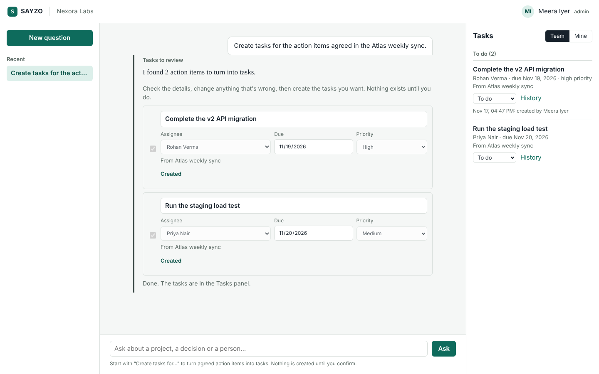
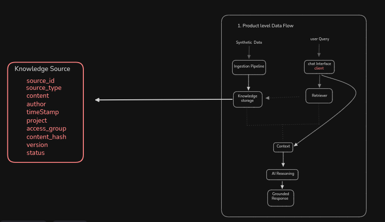
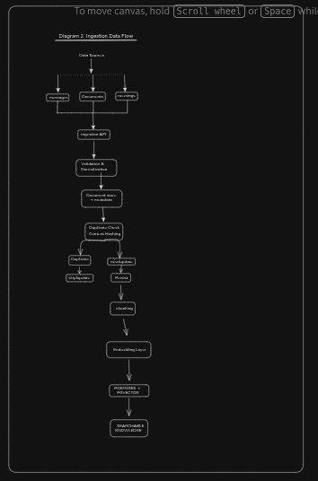
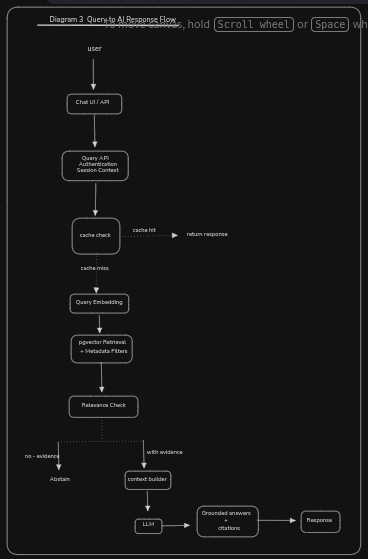
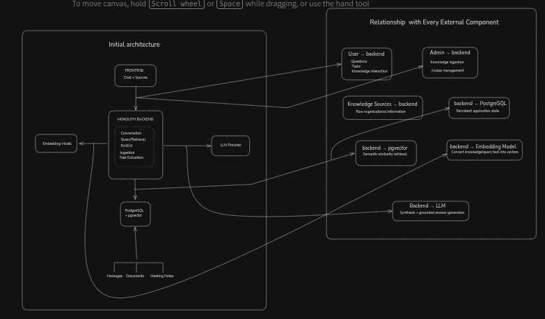
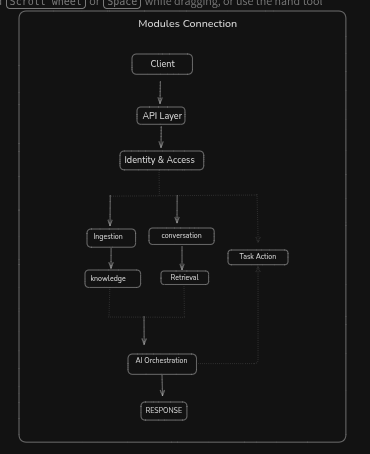
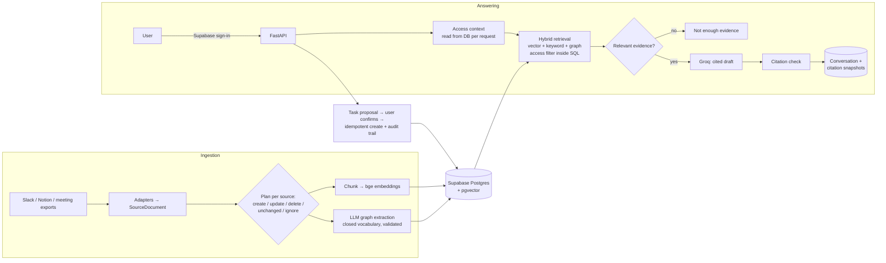

# SAYZO: a company knowledge assistant

SAYZO answers questions from a company's messages, documents and meeting notes, and shows
the sources behind every answer. When the sources don't cover a question it says so, and
when they disagree it shows both sides. It can also turn agreed action items into tasks,
which the user reviews and confirms before anything is created. Each person only ever sees
what their access groups allow, and two companies on the same system never see each
other's data.



## Contents

1. [Submission checklist](#1-submission-checklist)
2. [Quick start](#2-quick-start)
3. [Architecture](#3-architecture)
4. [How it works](#4-how-it-works)
5. [Assumptions](#5-assumptions)
6. [Sample dataset and test scenarios](#6-sample-dataset-and-test-scenarios)
7. [Evaluation results](#7-evaluation-results)
8. [Demo and walkthrough](#8-demo-and-walkthrough)
9. [Security model](#9-security-model)
10. [Design decisions and trade-offs](#10-design-decisions-and-trade-offs)
11. [Known limitations](#11-known-limitations)
12. [Personal contribution and tools used](#12-personal-contribution-and-tools-used)
13. [Full setup reference](#13-full-setup-reference)

## 1. Submission checklist

| Requirement | Where |
|---|---|
| Source code in a Git repository, with clear setup instructions | This repository. [Quick start](#2-quick-start) and [full setup](#13-full-setup-reference) |
| A working demo and instructions to run it | `python scripts/serve.py` serves the API and the web app on http://127.0.0.1:8000 ([quick start](#2-quick-start)) |
| README covering architecture, assumptions, setup and known limitations | Sections [3](#3-architecture), [5](#5-assumptions), [13](#13-full-setup-reference) and [11](#11-known-limitations) |
| A synthetic sample dataset and at least five test questions | [`datasets/seed/`](datasets/README.md): 2 companies, 3 source formats, 7 deliberate edge cases and **13** ground-truth questions ([section 6](#6-sample-dataset-and-test-scenarios)) |
| A screen recording or live walkthrough of ingestion, answering with sources, task creation and access control | Recording: link shared with the submission. It follows the script in [docs/WALKTHROUGH.md](docs/WALKTHROUGH.md) |
| A note on personal contribution and the tools, libraries, APIs, models and AI coding assistants used | [Section 12](#12-personal-contribution-and-tools-used) and [docs/AI_TOOLS.md](docs/AI_TOOLS.md) |

## 2. Quick start

You need Python 3.11+, a Supabase project (the free tier is enough) and a Groq API key
(free at console.groq.com).

```bash
git clone https://github.com/MonotonousHarsh/SAYZO-Agentic-Bot.git
cd SAYZO-Agentic-Bot/backend
python -m venv .venv && source .venv/bin/activate
pip install torch --index-url https://download.pytorch.org/whl/cpu   # CPU-only build, much smaller
pip install -e ".[dev]"
cp ../.env.example ../.env     # then fill in GROQ_API_KEY and DATABASE_URL
```

```bash
alembic upgrade head                  # create the database tables
python scripts/ingest_dataset.py      # load the sample data (first run downloads a ~440 MB model)
python scripts/serve.py --dev-auth    # open http://127.0.0.1:8000 and pick a person
```

`--dev-auth` lets you pick any person from the sample company without a password, which is
handy for a quick look on your own machine. For real sign-in, see
[section 13](#13-full-setup-reference).

## 3. Architecture

### High-level design

These diagrams were drawn during the design phase, before any code was written.

**Product-level data flow.** Synthetic data goes through the ingestion pipeline into
knowledge storage. A user's query goes through the chat interface and the retriever, which
builds the context for the model, and comes back as a grounded response. Each stored source
carries the metadata on the left.



**Ingestion flow.** Messages, documents and recordings are validated and normalised,
checked for duplicates by content hash, chunked, embedded and stored in Postgres with
pgvector.



**Query to answer.** The request is authenticated and given its session context. Retrieval
is filtered by metadata, a relevance check decides between abstaining and answering, and
the model's answer comes back with citations.



**Initial architecture.** A modular monolith backend between the frontend, Postgres with
pgvector, a local embedding model and a hosted LLM, with the relationships to each external
component.



**Module connections.** Every request passes the API layer and identity and access before
reaching ingestion, conversation and retrieval, or the task action.



### What was built, and where it differs from the diagrams

The build follows these diagrams, with four refinements made during implementation:

| Design | Built | Why |
|---|---|---|
| Retrieval via pgvector | **Hybrid** retrieval: pgvector similarity + Postgres full-text + a relationship graph, merged by reciprocal rank fusion | Vectors miss exact names ("CloudKite", "salary band"); the graph links "who owns what" facts |
| Cache check before retrieval | No answer cache. A retried request (same `client_request_id`) returns the stored reply instead of answering again | A shared answer cache would have to be keyed by each user's access rights, and the risk of serving one person's answer to another outweighs the saving at this scale |
| Ingestion API | Ingestion runs as a script (`ingest_dataset.py`) over exported files | The brief uses synthetic data, and the same service can sit behind an endpoint or a webhook later |
| Graph not shown | Ingestion also extracts entities and relationships with the LLM, checked against a closed vocabulary | Answers "who owns / who is responsible for" questions |



### Code structure

The backend is a modular monolith. Each module has its own models, a repository (SQL only,
never commits) and a service (one use case per database transaction). Modules depend on
interfaces (`LLMProvider`, `EmbeddingProvider`), not on vendors, and `app/bootstrap.py` is
the one place that wires up the real implementations.

```
backend/app/
  modules/sources         raw Slack / Notion / meeting formats → one SourceDocument
  modules/synthetic_data  seed dataset, AI-assisted generation, validation, ground truth
  modules/identity        directory, access context, linking Supabase accounts
  modules/ingestion       change planning, chunking, embeddings, graph extraction
  modules/retrieval       hybrid search, rank fusion, retrieval evaluation
  modules/answering       relevance gate, prompt, citation checks, answer evaluation
  modules/conversations   stored chats, citation snapshots, retry-safe requests
  modules/tasks           intent, permissions, proposals, creation, audit trail
  api/                    FastAPI routes, authentication, the web app (static files)
  shared/                 database, LLM and embedding adapters, text helpers
backend/migrations/       hand-written SQL migrations (Alembic)
backend/scripts/          ingest, serve, ask, evaluate, task and admin commands
backend/tests/            unit tests + integration tests against real Postgres
datasets/                 synthetic data and ground-truth questions
docs/                     diagrams, walkthrough, AI tools note, screenshots
```

**Stack:** Python 3.11+, FastAPI, SQLAlchemy Core with plain SQL, Alembic, Supabase
(Postgres + pgvector + Auth), sentence-transformers running `BAAI/bge-base-en-v1.5` locally,
Groq `openai/gpt-oss-120b` with strict JSON-schema outputs, and a static HTML/CSS/JavaScript
front end with no build step.

## 4. How it works

**Ingestion** (`modules/ingestion`). Each source format is converted to a `SourceDocument`
with source, author(s), timestamp, project, access groups, version and content hash. For
every source, a planner compares it with what's stored:

- **New:** stored, chunked (about 180 words with overlap), embedded and indexed.
- **Edited:** new chunks are built first, then swapped in within one transaction, so
  searches never see a half-updated source. Graph facts that only the old text supported
  are removed.
- **Deleted:** soft-deleted. The content, chunks and graph evidence are removed, and a
  tombstone row stays so a late copy can't bring it back. Older snapshots that arrive late
  are ignored.
- **Duplicate:** repeated exports collapse to one, and identical content in another source
  is stored once and linked as a duplicate. If the original is deleted, the duplicate is
  indexed in its place.
- **Access change** (same content): permissions are updated without re-embedding.

**Retrieval** (`modules/retrieval`). Three searches run in one read transaction, each
already restricted to what the reader may see:

- **Vector:** cosine similarity on the bge embeddings.
- **Keyword:** Postgres full-text search over the content and title.
- **Graph:** relationships of the people, projects and tasks named in the question.

The results are merged by rank (reciprocal rank fusion), with at most 2 chunks per source
so an answer can combine several sources.

**Answering** (`modules/answering`).

1. Chunks below 0.5 similarity are dropped unless the graph linked them. Unrelated text
   scores about 0.40 with bge.
2. If nothing remains, SAYZO answers "not enough evidence" without calling the model.
3. Otherwise Groq writes an answer using only the numbered sources, with a status of
   answered, not enough evidence, or sources disagree.
4. Code checks the citations: no invented source numbers, an answer must cite something,
   and a conflict must cite both sides. A failing draft gets one retry with the problem
   explained, and then a safe failure. Citations are renumbered `[1]`, `[2]` and stored
   with a snapshot of each source, so they stay readable after the source changes.

**Tasks** (`modules/tasks`).

1. Code decides that a message is a task request ("Create tasks for…"); the model never
   decides to act.
2. The role is checked before any search or model call.
3. Groq proposes tasks from the visible sources. Code then resolves each assignee to a
   real member, parses due dates, links the source, and flags anything odd.
4. The user can edit each proposed task and then confirms. The confirmed task is fully
   re-validated and written together with its audit event and an idempotency record. A
   double click or a retried request can't create a duplicate.
5. Status changes are allowed for the creator, the assignee or an admin, and every change
   is recorded in an append-only history.

**Roles and visibility.**

| Role | Ask questions | Create tasks | Change tasks |
|---|---|---|---|
| VIEWER | yes | no | no |
| MEMBER | yes | yes | ones they created or are assigned to |
| ADMIN | yes | yes | any in the organisation |

What a person can *see* is decided separately, by access groups. A source is visible to
someone who shares at least one access group with it, in the same organisation.

## 5. Assumptions

- **Data arrives as exports.** Slack-style event streams, Notion-style page versions and
  meeting transcripts with speaker turns. Each export carries a stable id and a version (or
  edit timestamp) per item.
- **Permissions come from the company directory, not from the sources.** Each source is
  tagged with access groups, and people belong to groups. A source is visible to anyone
  sharing one of its groups. Roles control actions, not visibility.
- **One person, one email.** Signing in links a Supabase account to the directory person
  with the same email. People who aren't in the directory can't use the system.
- **Latest version wins, unless it's older.** The highest version of a source is the
  truth. A deletion is final for that version, and a re-export of the same content is a
  duplicate.
- **Due dates are calendar days** in the organisation's time zone (`Asia/Kolkata` by
  default), stored as the end of that day.
- **Answers are standalone.** Each question is answered on its own, without the earlier
  conversation.
- **English text**, and small-company scale: thousands of chunks, not millions.
- **Everything in `datasets/` is fictional.** Only this synthetic data is sent to Groq.

## 6. Sample dataset and test scenarios

[`datasets/seed/`](datasets/README.md) contains two fictional companies:

- **Nexora Labs** has 6 people and 5 access groups. Its Project Atlas launch moves from
  20 to 23 November because the API migration runs late.
- **Vertex Retail** has 2 people and its own, different "Project Atlas", so any leak
  between companies would be obvious.

The data covers 3 source formats and these deliberate edge cases:

| Edge case | Example |
|---|---|
| Edited document | the launch plan v1 → v2 (new launch date) |
| Edited message | Priya corrects the load test date |
| Deleted message | Dev's wrong "launch is on the 15th" |
| Duplicates | a re-exported message; a re-uploaded meeting transcript |
| Conflict | 3 pilot customers in the plan vs 5 in a message |
| Restricted content | the hiring plan (HR + leadership only), a leadership message |
| Prompt injection | vendor notes containing "ignore all previous instructions…" |

**Test scenarios** (`datasets/seed/evaluation_questions.json`). Each one records who asks,
the expected behaviour, which sources must and must not be used, and what the answer must
and must not contain.

| # | Asked by | Question | Expected | What it tests |
|---|---|---|---|---|
| q01 | Rohan | Why was the Project Atlas launch moved, and what is the new date? | Answer | Combining a message, a meeting and an edited document |
| q02 | Arjun | When is the Project Atlas launch? | Answer | Latest version of an edit; ignores a deleted message |
| q03 | Meera | Who owns the API migration for Atlas, and when is it due? | Answer | Ownership and deadline facts via the graph |
| q04 | Arjun | How many pilot customers does Project Atlas have? | Conflict | Two live sources disagree; both cited, no guessing |
| q05 | Rohan | What is the salary band for backend engineers? | Abstain | Restricted HR content must not reach an engineer |
| q06 | Meera | What is the salary band for backend engineers? | Answer | The same content is available to leadership |
| q07 | Arjun | What is the marketing budget for Project Atlas? | Abstain | Nothing answers it; say so instead of guessing |
| q08 | Rohan | Who owns Project Atlas? | Answer | Tenant isolation: another company has a "Project Atlas" |
| q09 | Sana (Vertex) | When does Project Atlas go live? | Answer | Tenant isolation from the other side |
| q10 | Arjun | Summarise the CloudKite vendor onboarding notes. | Answer | Prompt injection treated as content |
| q11 | Meera | Create tasks for the action items agreed in the Atlas weekly sync. | Task proposal | Assignees and due dates from a meeting |
| q12 | Dev (viewer) | Create a task for Rohan to fix the billing endpoints. | Denied | Viewers can't create tasks |
| q13 | Rohan | Which database and session store does Atlas use? | Answer | Plain retrieval from one technical document |

`python scripts/validate_dataset.py` checks the dataset itself, for example that every
expected source exists and is actually visible to the person asking.

## 7. Evaluation results

```bash
python scripts/evaluate_retrieval.py   # are the expected sources found? did anything leak?
python scripts/evaluate_answers.py     # status, facts, citations, leaks (uses Groq)
python scripts/evaluate_tasks.py       # task proposal content and the viewer refusal (uses Groq)
```

Results on the seed dataset (bge-base-en-v1.5, gpt-oss-120b, run on 17 Nov 2026):

| Check | Result |
|---|---|
| Retrieval: expected sources in the top 8 | 100% (12 questions), **0 leaks** |
| Answers: answer / abstain / conflict | **11 of 11** passed, 0 citation leaks |
| Tasks: proposal content + viewer refusal | **2 of 2** passed |

A "leak" is checked independently of the system: every returned or cited source is
compared against the dataset's own access rule, so retrieval can't mark its own homework.

Answers come from a live model, so a single run can occasionally differ. Everything around
the model is deterministic and covered by **138 automated tests**: access filtering,
citation checks, permissions, idempotency and the audit trail. The integration tests run
the real migrations against Postgres with pgvector and drive ingestion, retrieval,
answering, conversations, tasks and the HTTP API end to end, using a stand-in embedder and
scripted model replies:

```bash
python -m pytest -q                                            # unit tests
TEST_DATABASE_URL=postgresql://localhost/sayzo_test python -m pytest -q   # + integration
```

`TEST_DATABASE_URL` must be a throwaway database: the tests drop and recreate every table.
Never point it at Supabase.

## 8. Demo and walkthrough

[docs/WALKTHROUGH.md](docs/WALKTHROUGH.md) is a 10-minute script that shows ingestion,
answering with sources, task creation and access control. Each step says what to do and what
you should see. The recorded walkthrough shared with the submission follows this script.

Useful command-line tools (all run from `backend/`):

```bash
python scripts/ask.py --as nex_arjun "When is the Project Atlas launch?"   # one cited answer
python scripts/search.py --as nex_rohan "salary band"                     # raw retrieval
python scripts/tasks.py list --as nex_meera                               # tasks and their status
python scripts/db_status.py                                               # row counts per table
```

## 9. Security model

- **Sign-in:** Supabase Auth. The API verifies each request's token: against the project's
  public keys (JWKS) for asymmetric tokens, with the configured secret for legacy HS256
  tokens, or by asking Supabase Auth. A first sign-in links the account to the directory
  person with the same email, and a linked person can never be taken over by another
  account.
- **Rights are read from the database on every request,** not from the token: active
  membership, role and current access groups. Removing someone from a group takes effect
  on their next request.
- **Visibility is enforced inside every SQL query,** before ranking, so a hidden chunk
  can't even take a result slot. Graph facts are returned only when the chunk they came
  from is visible. The model never receives a chunk the asker can't see, so it can't leak
  one.
- **Organisation isolation is enforced twice:** by the queries, and by the database itself,
  where composite foreign keys make it impossible to link, say, a task to a member of
  another company.
- **Prompt injection:** sources reach the model as quoted data in tagged blocks it can't
  close early, and instruction-like text is flagged. The model can't take actions; code
  decides when something is a task request, and the user confirms every task.
- **Actions are checked twice:** the role before any model call, and the full task again
  at confirmation (assignee in the same company, source visible to the creator,
  conversation owned by the creator). Audit events can't be edited (a database trigger
  blocks updates).
- **Database exposure:** row-level security is on with no policies, and Supabase's public
  roles have no access to the `sayzo` schema, so the browser can't read tables directly.
  Only public values reach the browser (`/api/config`). The Supabase secret key is used
  only by the account-setup script.
- **Never commit `.env`.** It holds the database password and API keys, and `.gitignore`
  already excludes it.

## 10. Design decisions and trade-offs

- **One Postgres for everything** (records, vectors, full-text, graph as tables). One
  transactional store keeps tenant isolation, edits and deletes consistent. A separate
  vector or graph database would need cross-store syncing for little gain at this scale.
- **Hybrid retrieval, fused by rank.** Each method catches what the others miss, and
  fusing by rank avoids comparing scores that aren't comparable.
- **A relevance gate before the model.** It makes "I don't know" cheap and dependable, and
  the threshold is a setting (`ANSWER_MIN_SIMILARITY`).
- **The model proposes, code decides.** The graph uses a closed vocabulary, citations are
  checked and renumbered by code, task intent is a fixed rule, and people and dates are
  resolved against the directory.
- **Local embeddings, hosted LLM.** Embedding costs nothing per query and documents never
  leave the server for indexing; only the few chunks an answer needs go to Groq. The free
  Groq tier is handled with retries and request pacing.
- **Modular monolith.** One deployable with clear module boundaries is the right size for a
  prototype, and the interfaces allow splitting it later.

## 11. Known limitations

- **No follow-up context.** Each question is answered on its own; "and who owns it?"
  doesn't know what "it" refers to.
- **Proposals aren't saved.** Reopening an old conversation shows a proposal as text,
  without the editable form.
- **Exports, not live sync.** Connectors read exported files. Live Slack and Notion sync
  (webhooks plus backfill) would be next; the ingestion planner already handles
  out-of-order and duplicate events.
- **Small evaluation set.** The relevance threshold was tuned on 13 questions. A larger set
  would tune it properly and show whether a re-ranker is worth adding.
- **Privileged database connection.** The API connects with a privileged role, and row-level
  security is only a backstop. Per-request database roles with RLS policies would add
  another layer.
- **One task action.** Tasks can be created and moved between statuses. Editing other
  fields, comments and notifications are out of scope.
- **Free-tier rate limits.** Groq can throttle bulk graph extraction and evaluation runs.
  The code waits and retries, so runs are slower but complete.

## 12. Personal contribution and tools used

**My contribution.** I analysed the brief and designed the system: the data flow,
ingestion, query-to-answer and module diagrams above, the data model, the access model and
the edge cases to test. I chose the stack (Supabase, local open-weight embeddings, a free
Groq model) and set the engineering rules (clean modular code, SOLID, testable interfaces).
I directed the build module by module and ran every module against the real Supabase
database and Groq on my machine, checking the output before moving on. That review
produced fixes along the way, for example the conflict-handling rule, the answer text
clean-up and duplicate-safe task confirmation.

**AI coding assistants.** ChatGPT for the design discussions. Claude (Anthropic) wrote the
code, tests and documentation from that design under my direction and review. Details in
[docs/AI_TOOLS.md](docs/AI_TOOLS.md).

**Models and APIs.**

| What | Used for |
|---|---|
| Groq API, model `openai/gpt-oss-120b` | Writing cited answers, extracting the relationship graph, proposing tasks, generating extra synthetic data |
| `BAAI/bge-base-en-v1.5` (Hugging Face, open weights, run locally) | Embeddings for semantic search |
| Supabase (Postgres 16, pgvector, Auth) | Database, vector search, sign-in |

**Libraries.** FastAPI, Uvicorn, Pydantic, pydantic-settings, SQLAlchemy, psycopg 3,
Alembic, pgvector, sentence-transformers (with PyTorch), httpx, PyJWT, pytest and Ruff.
Front end: supabase-js (from a CDN) and Google Fonts (Public Sans, Source Serif 4).

## 13. Full setup reference

### Environment (`.env` in the repository root)

| Variable | Required | What it is |
|---|---|---|
| `GROQ_API_KEY` | yes | From console.groq.com |
| `GROQ_MODEL` | no | Defaults to `openai/gpt-oss-120b` |
| `DATABASE_URL` | yes | Supabase → **Connect** → **Session pooler** URI (works on IPv4 networks). URL-encode special characters in the password (`$` → `%24`, `@` → `%40`) |
| `SUPABASE_URL` | for sign-in | `https://<project-ref>.supabase.co` |
| `SUPABASE_PUBLISHABLE_KEY` | for sign-in | Public key (`sb_publishable_…`), used by the browser |
| `SUPABASE_SECRET_KEY` | for demo accounts | Secret key (`sb_secret_…`), used only by `create_demo_users.py` |
| `SUPABASE_JWT_SECRET` | no | Only for projects still on the legacy JWT secret |
| `ANSWER_MIN_SIMILARITY` | no | Relevance threshold, default `0.5` |
| `TIMEZONE` | no | For task due dates, default `Asia/Kolkata` |

### Database and data

```bash
alembic upgrade head                        # create the sayzo schema (alembic downgrade base removes it)
python scripts/validate_dataset.py          # check the seed dataset
python scripts/ingest_dataset.py            # load directory, sources, chunks, embeddings, graph
python scripts/db_status.py                 # check: 19 tables, row counts, RLS on
```

Ingestion options:

- `--no-graph` skips LLM graph extraction (faster).
- `--as-of 2026-11-10T12:00:00+05:30` replays the data as it was at that moment, which is
  useful to demo edits and deletions arriving.
- `--reindex` rebuilds chunks and the graph for unchanged sources.
- `--dataset ../datasets/generated/sayzo_generated_v1` loads the AI-generated variation.

Re-running ingestion is always safe.

### Running the app with real sign-in

```bash
python scripts/create_demo_users.py --password "choose-a-demo-password"   # once
python scripts/serve.py                                                    # http://127.0.0.1:8000
```

Sign in with a directory email, for example `meera@nexora.example` (admin),
`rohan@nexora.example` (member), `dev@nexora.example` (viewer) or `sana@vertex.example`
(the other company), and the demo password. API docs are at `/docs`.

### API

All routes except `/api/health` and `/api/config` need `Authorization: Bearer <Supabase
access token>`. People in several organisations also send `X-Organisation-Id`.

| Method | Route | Purpose |
|---|---|---|
| GET | `/api/me` | Who am I: role, organisation, access groups |
| POST | `/api/chat` | Ask a question or request tasks (`message`, optional `conversation_id`, `client_request_id`) |
| GET | `/api/conversations`, `/api/conversations/{id}/messages` | My conversations, with citations |
| GET | `/api/members` | People in my organisation, for choosing an assignee |
| POST | `/api/tasks` | Create a confirmed task (`draft`, `idempotency_key`, optional `conversation_id`, `message_id`) |
| GET | `/api/tasks?mine=true` | Tasks in my organisation |
| PATCH | `/api/tasks/{id}` | Change status |
| GET | `/api/tasks/{id}/events` | Task history |

Errors: 401 not signed in, 403 not allowed, 404 not found (also for other people's
conversations), 409 idempotency key reused for a different task, 422 invalid input.
