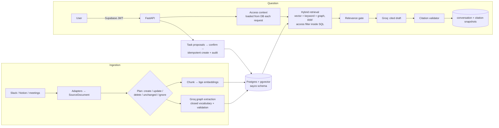

# SAYZO: a company knowledge assistant (prototype)

SAYZO answers questions about a company's messages, documents and meetings, with citations
to the exact sources it used. It says so when the sources don't support an answer or
disagree with each other, and it can turn agreed action items into tasks after the user
confirms. Every person sees only what their access groups allow, and organisations never
see each other's data.

- [Walkthrough (demo script)](docs/WALKTHROUGH.md)
- [AI tools used](docs/AI_TOOLS.md)
- [Datasets and edge cases](datasets/README.md)

## What it does, mapped to the brief

| Requirement | How SAYZO does it | Where |
|---|---|---|
| Ingest messages, documents, meeting notes with metadata | Slack-style events, Notion-style page versions and meeting transcripts are converted to one `SourceDocument` with source, author(s), timestamp, project and access groups | `app/modules/sources`, `app/modules/ingestion` |
| Persistence | Supabase Postgres + pgvector, 19 tables in a private `sayzo` schema, hand-written SQL migrations | `migrations/` |
| Edits | New version → new chunks swapped in atomically; old chunks and their graph evidence removed | `ingestion/service.py` |
| Deletions | Soft delete: content and chunks removed, row kept as a tombstone; late or stale snapshots ignored | `ingestion/planning.py` |
| Duplicates | Repeated exports collapsed; identical content stored once and linked with `duplicate_of_source_id`; promoted if the original is deleted | `ingestion/service.py` |
| Grounded Q&A with citations | Hybrid retrieval → relevance gate → Groq drafts a cited answer → code validates every citation | `app/modules/retrieval`, `app/modules/answering` |
| Abstention | No relevant visible evidence → "not enough evidence" without calling the model; the model can also abstain | `answering/evidence.py` |
| Combining sources and conflicts | Up to 6 sources per answer, max 2 chunks per source; disagreements reported with both sides cited | `retrieval/service.py`, `answering/prompt.py` |
| One working action | Tasks: proposed from sources, confirmed by the user, created idempotently with an append-only audit trail | `app/modules/tasks` |
| Role-based access | VIEWER read-only, MEMBER creates and edits own tasks, ADMIN all; access groups decide what can be seen | `tasks/policy.py`, `retrieval/repository.py` |
| Organisation isolation | Every query is scoped by organisation; composite foreign keys make cross-tenant rows impossible in the database | `0001_initial_schema.up.sql` |
| ≥ 5 test questions | 13 ground-truth questions with expected behaviour and sources, plus three evaluation scripts | `datasets/seed/evaluation_questions.json` |

## Architecture



**Stack:** Python 3.11+, FastAPI, SQLAlchemy Core with plain SQL, Alembic, Supabase
(Postgres 16 + pgvector + Auth), `BAAI/bge-base-en-v1.5` embeddings run locally with
sentence-transformers, Groq `openai/gpt-oss-120b` with strict JSON-schema outputs. The UI is
one static HTML/JS page served by the API.

**Code layout** (`backend/app`): one module per concern. Each has its models, a repository
(SQL only, never commits) and a service (one use case per transaction through
`UnitOfWork`). Modules depend on interfaces (`LLMProvider`, `EmbeddingProvider`), not
vendors, and `app/bootstrap.py` is the only place that wires real implementations.

```
modules/sources        raw formats → SourceDocument
modules/synthetic_data seed + AI-assisted dataset generation, validation, ground truth
modules/identity       directory seeding, access context, Supabase user linking
modules/ingestion      planning, chunking, embeddings, graph extraction
modules/retrieval      hybrid search, rank fusion, retrieval evaluation
modules/answering      relevance gate, prompt, citation checks, answer evaluation
modules/conversations  stored chats, citation snapshots, idempotent retries
modules/tasks          intent, policy, proposals, idempotent creation, audit, evaluation
api                    FastAPI routes, auth, static UI
```

## Security model

- **Authentication:** Supabase Auth. The API verifies the user's JWT: against the project's
  JWKS for asymmetric keys, with the configured secret for legacy HS256, or by asking
  Supabase Auth. On first sign-in the account is linked to the directory profile with the
  same email. A linked profile can never be taken over by another account.
- **Authorisation is decided from the database on every request,** not from the token:
  active membership, role and current access groups. Removing someone from a group takes
  effect on their next request.
- **Visibility is enforced inside every SQL query,** before ranking and limiting: same
  organisation, live, indexed, not a duplicate, current version, and sharing an access group
  with the reader. Graph facts are only returned when their evidence chunk is visible. The
  model never sees a chunk the asker can't see, so it can't leak one.
- **Prompt injection:** sources reach the model as quoted data in tagged blocks it can't
  break out of. Sources containing instruction-like text are flagged. Code, never the model,
  decides whether a message is a task request, and nothing is created without the user's
  confirmation.
- **Actions** are checked twice: the role is checked before any model call, and the
  confirmed task is fully re-validated (assignee in the same organisation, evidence visible
  to the creator, conversation owned by the creator). Idempotency keys make retries and
  double clicks safe. `task_events` is append-only, enforced by a trigger.
- **Database:** RLS is enabled with no policies, and Supabase's `anon` and `authenticated`
  roles are revoked from the `sayzo` schema. The browser can't read tables directly; only
  the API (server-side database URL) can. The Supabase secret key is used only by a setup
  script, and the browser receives only public values (`/api/config`).

## Running it

Prerequisites: Python 3.11+, a Supabase project (free tier is fine) and a Groq API key.

```bash
cd backend
python -m venv .venv && source .venv/bin/activate
pip install torch --index-url https://download.pytorch.org/whl/cpu   # CPU build, much smaller
pip install -e ".[dev]"
cp ../.env.example ../.env        # then fill in GROQ_API_KEY, DATABASE_URL, SUPABASE_*
```

Set up the database and data:

```bash
alembic upgrade head                       # create the sayzo schema
python scripts/validate_dataset.py         # check the seed dataset
python scripts/ingest_dataset.py           # directory, sources, chunks, embeddings, graph
python scripts/db_status.py                # row counts per table
```

The first ingest downloads the embedding model (~440 MB). Graph extraction makes one Groq
call per chunk, paced for the free tier; add `--no-graph` to skip it. Re-running is safe:
unchanged sources are skipped. `--as-of 2026-11-10T12:00:00+05:30` replays an earlier state,
and `--reindex` rebuilds everything.

Start the app:

```bash
python scripts/create_demo_users.py --password "pick-a-demo-password"   # once
python scripts/serve.py                                                  # http://127.0.0.1:8000
```

Sign in with any directory email (for example `meera@nexora.example`) and the demo password.
For a quick local look without Supabase accounts, use `python scripts/serve.py --dev-auth`:
you pick a person from a list. It only runs on localhost.

### API

All routes except `/api/health` and `/api/config` need `Authorization: Bearer <Supabase
access token>`. Members of several organisations add `X-Organisation-Id`. Interactive docs
are at `/docs`.

| Method | Route | Purpose |
|---|---|---|
| GET | `/api/me` | Who am I: role, organisation, access groups |
| POST | `/api/chat` | Ask, or request tasks. Body: `message`, optional `conversation_id`, `client_request_id` |
| GET | `/api/conversations`, `/api/conversations/{id}/messages` | My conversations, with citation snapshots |
| POST | `/api/tasks` | Create a confirmed task. Body: `draft`, `idempotency_key`, optional `conversation_id`, `message_id` |
| GET | `/api/tasks?mine=true` | Tasks in my organisation |
| PATCH | `/api/tasks/{id}` | Change status (creator, assignee or admin) |
| GET | `/api/tasks/{id}/events` | Audit trail |

Errors: 401 not signed in, 403 not allowed, 404 not found (also for other people's
conversations), 409 idempotency key reused for a different task, 422 invalid input.

## Evaluation

The 13 questions in `datasets/seed/evaluation_questions.json` cover answering from combined
sources, edits, deletions, duplicates, conflicts, abstention, restricted documents, tenant
isolation, prompt injection, task proposals and a denied action.

```bash
python scripts/evaluate_retrieval.py   # recall of expected sources + leak check
python scripts/evaluate_answers.py     # status, facts, citations, leaks (Groq)
python scripts/evaluate_tasks.py       # task proposal content + viewer refusal (Groq)
```

Latest results on the seed dataset (bge-base, gpt-oss-120b):

| Check | Result |
|---|---|
| Retrieval recall@8 | 100%, 0 leaks |
| Answers (answer / abstain / conflict) | 11 of 11 passed, 0 citation leaks |
| Tasks (proposal + denial) | 2 of 2 passed |

Answers come from a live model, so an individual run can occasionally vary. The checks
around the model (access filtering, citation validation, permissions, idempotency) are
deterministic and covered by the test suite.

### Tests

```bash
python -m pytest -q                                   # unit tests
TEST_DATABASE_URL=postgresql://... python -m pytest   # + integration tests (throwaway DB!)
```

The integration tests run migrations up and down against a real Postgres with pgvector and
exercise ingestion, retrieval, answering, conversations, tasks and the HTTP API, with a
deterministic stand-in embedder and scripted LLM replies. `TEST_DATABASE_URL` must never
point at the Supabase project: the tests drop every table.

## Design decisions and trade-offs

- **Postgres for everything** (relational data, vectors, full-text, graph as tables):
  one transactional store makes tenant isolation, edits and deletes consistent. A separate
  vector or graph database would need cross-store consistency for little gain at this scale.
- **Hybrid retrieval with rank fusion:** vectors catch paraphrase, keywords catch exact
  names ("CloudKite", "salary band"), and the graph links "who owns what" facts. Fusing by
  rank avoids comparing incompatible scores.
- **Relevance gate before the model:** unrelated text scores ~0.40 cosine with bge, and real
  matches score well above that. Gating at 0.5 makes "I don't know" cheap and reliable, and
  the threshold is configurable.
- **The model proposes, code decides:** the graph uses a closed vocabulary checked by code,
  citations are validated and renumbered by code, the task intent is a deterministic rule,
  and assignees and dates are resolved by code.
- **Local embeddings, hosted LLM:** documents are embedded on the server at no per-query
  cost, and only the few chunks an answer needs are sent to Groq. Groq's free tier keeps the
  LLM free, with retries and pacing for rate limits.

## Known limitations and next steps

- Each question is answered on its own; follow-up questions don't use the conversation
  history yet.
- Proposals live in the chat response, not the database. Reopening an old conversation
  shows the proposal text but not the Confirm buttons.
- Connectors read exported files; live Slack/Notion sync (webhooks + backfill) is the
  natural next step, and the ingestion planner already handles out-of-order events.
- The relevance threshold is calibrated on a small corpus; a larger evaluation set would
  tune it and could add a re-ranker.
- Supabase RLS is a backstop. All access goes through the API, which uses a privileged
  connection. Per-request database roles with RLS policies would add defence in depth.
